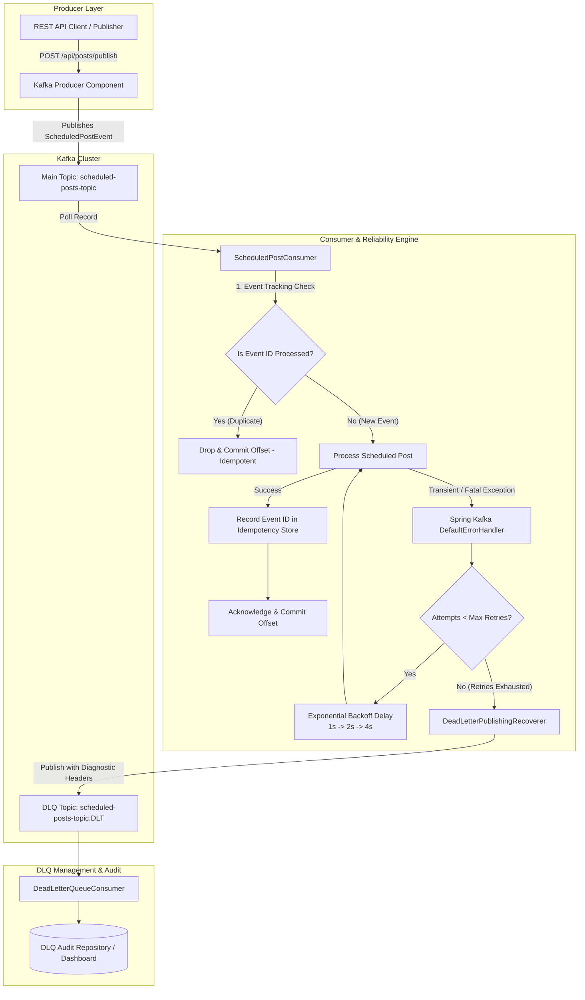

# Lab Report: Reliability Mechanisms in Event-Driven Systems Using Apache Kafka
**Experiment Title:** Asynchronous Processing of Scheduled Posts with Retry Strategies, Dead-Letter Queues (DLQ), and Idempotency Patterns

---

## 1. Experiment Overview & Academic Mapping

- **Aim:** To implement reliability mechanisms in an event-driven system using retry strategies, dead-letter queues (DLQ), and idempotency patterns.
- **Objectives:**
  1. Understand failure handling in distributed, asynchronous event-driven architectures.
  2. Implement retry mechanisms with exponential backoff.
  3. Configure and route failed messages to Dead-Letter Queues (DLQ).
  4. Ensure idempotent processing of messages using event tracking.
- **Course Outcomes (CO) & Bloom's Taxonomy (BT) Mapping:**
  - **CO2 - BT2 (Understand):** Explain asynchronous communication, at-least-once delivery trade-offs, and failure recovery.
  - **CO3 - BT3 (Apply):** Implement `DefaultErrorHandler` with `ExponentialBackOff` and configure `DeadLetterPublishingRecoverer`.
  - **CO5 - BT5 (Evaluate):** Evaluate message deduplication techniques, verify idempotency consistency, and audit DLQ messages.

---

## 2. Distributed Architecture Design



---

## 3. Core Implementation Details

### 3.1 Retry Mechanism with Exponential Backoff
- Implemented in `KafkaConfig.java` using Spring Kafka's `DefaultErrorHandler` coupled with `ExponentialBackOffWithMaxRetries`.
- Configured parameters:
  - **Initial Interval:** `1000 ms`
  - **Backoff Multiplier:** `2.0`
  - **Max Interval:** `10000 ms`
  - **Max Attempts:** `3` (1 initial attempt + 2 exponential retries)
- Custom retry listener logs intermediate retry counts, partition offsets, and elapsed delays.

### 3.2 Dead-Letter Queue (DLQ) & Error Recovery
- Registered `DeadLetterPublishingRecoverer` to intercept records after retry exhaustion.
- Enriches message headers with error context:
  - `kafka_dlt-original-topic`
  - `kafka_dlt-original-partition`
  - `kafka_dlt-original-offset`
  - `kafka_dlt-exception-message`
  - `kafka_dlt-exception-stacktrace`
- `DeadLetterQueueConsumer` listens on `scheduled-posts-topic.DLT`, safely decodes binary and string headers, and stores records in `DlqAuditService`.

### 3.3 Idempotency Pattern (Event Tracking / Deduplication)
- Kafka guarantees **at-least-once delivery**, which means duplicate delivery can occur during network rebalances or retries.
- Each event is assigned a globally unique `eventId` (UUID).
- `IdempotencyService` manages an atomic registry using `ConcurrentHashMap.putIfAbsent()`.
- If an event arrives with an existing `eventId`, the consumer detects the duplicate, logs a warning, skips downstream execution, and commits the offset cleanly to prevent system re-triggering.

---

## 4. Test Scenarios & Verification Results

The test suite in `KafkaReliabilityIntegrationTest.java` was executed against an embedded Apache Kafka KRaft cluster.

| # | Test Scenario | Expected Behavior | Observed Result | Status |
|---|---|---|---|---|
| **1** | **Normal Post Processing** | Post published, event ID stored in idempotency store. | `PostStatus.PUBLISHED`, event stored. | **PASSED** |
| **2** | **Idempotent Deduplication** | Duplicate event with identical `eventId` is intercepted and dropped. | Exactly 1 execution occurred; duplicate discarded cleanly. | **PASSED** |
| **3** | **Exponential Backoff Retry** | Downstream network glitch recovers on attempt #2 after backoff. | Succeeded on retry attempt 2; final status `PUBLISHED`. | **PASSED** |
| **4** | **DLQ Routing** | Fatal unrecoverable poison pill exhausts 3 retries and lands in DLQ. | Routed to `scheduled-posts-topic.DLT`; DLQ consumer logged failure headers. | **PASSED** |

### Maven Surefire Test Execution Summary
```
[INFO] Tests run: 4, Failures: 0, Errors: 0, Skipped: 0, Time elapsed: 10.71 s
[INFO] ------------------------------------------------------------------------
[INFO] BUILD SUCCESS
[INFO] ------------------------------------------------------------------------
```

---

## 5. REST API Interactive Testing Endpoints

| Endpoint | HTTP Method | Scenario Demonstrated |
|---|---|---|
| `/api/posts/publish` | `POST` | Normal event processing |
| `/api/posts/simulate-retry` | `POST` | Transient error triggering exponential backoff retry |
| `/api/posts/simulate-dlq` | `POST` | Fatal poison pill exhausting retries and routing to DLQ |
| `/api/posts/simulate-duplicate` | `POST` | Emitting identical events to verify idempotency deduplication |
| `/api/posts/idempotency-store` | `GET` | View all processed event IDs in tracking store |
| `/api/posts/dlq-records` | `GET` | View captured Dead-Letter Queue records with audit diagnostics |
| `/api/posts/statuses` | `GET` | View post lifecycle statuses (`PUBLISHED`, `FAILED_SENT_TO_DLQ`, etc.) |

---

## 6. Conclusion
The implementation successfully achieved all course and lab objectives:
1. **Resilience:** Transient failures automatically recover without human intervention via exponential backoff retries.
2. **System Health:** Unrecoverable messages do not block consumer partition progress; they are systematically routed to a Dead-Letter Queue (DLQ).
3. **Consistency:** Exactly-once semantics at the application level are guaranteed through idempotency event tracking.
